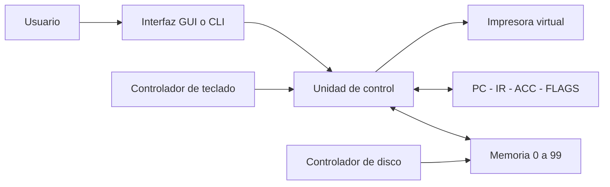
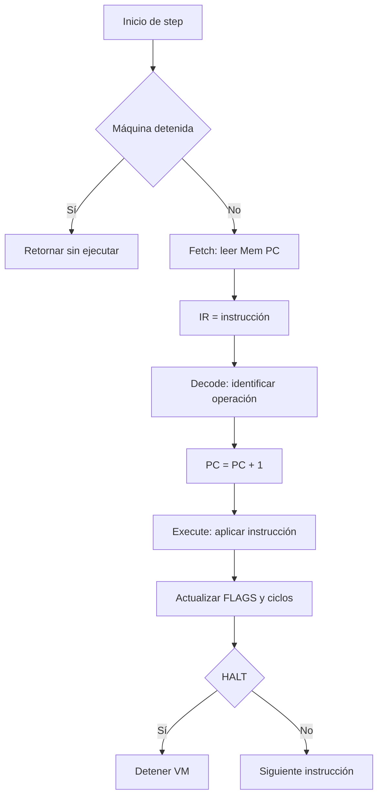
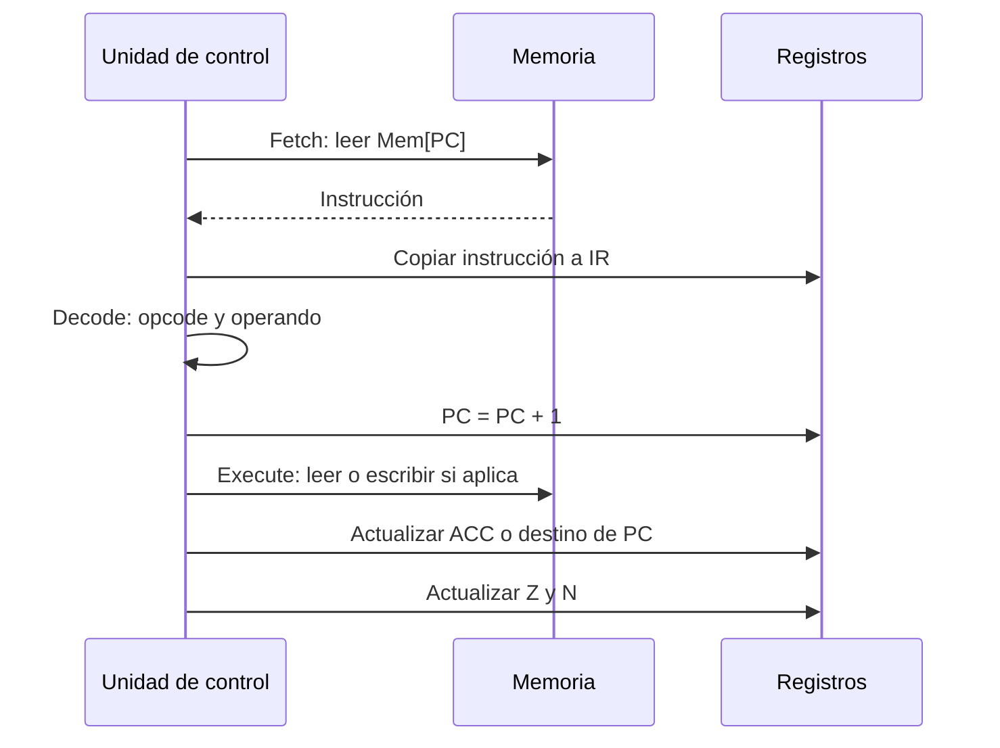
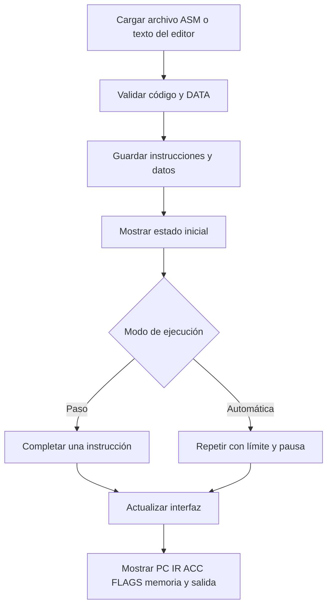

# Implementación de una máquina virtual simple

## Portada

**Institución:** [Completar institución]

**Asignatura:** Arquitectura de Sistemas Operativos

**Proyecto:** Implementación de una máquina virtual simple

**Grupo:** 13

**Integrantes:** [Completar integrantes]

**Docente:** [Completar docente]

**Fecha de entrega:** [Completar fecha de entrega]

**Fecha de revisión:** 26 de octubre de 2026

**Lenguaje de implementación:** Python 3

**Producto:** Simulador con memoria, registros, unidad de control, ciclo Fetch-Decode-Execute, dispositivos virtuales y pruebas reproducibles.

Este documento reúne el diseño y los casos de prueba del Entregable 1. El paquete incluye manual de usuario, manual técnico, evidencias de ejecución y guía de defensa para el Entregable 2. Los campos entre corchetes requieren datos reales del grupo antes de la impresión definitiva. La fecha de revisión identifica esta versión y no sustituye la fecha de entrega.

La propuesta menciona Python entre las opciones de implementación y también contiene indicaciones específicas de Java. El proyecto conserva Python según autorización consignada por el grupo. Este documento registra esa decisión; no constituye una verificación externa de la autorización docente.

## Introducción

Una máquina virtual permite estudiar el comportamiento de un procesador mediante un programa que representa su memoria, registros y reglas de ejecución. En este proyecto se construye una arquitectura didáctica con 100 celdas de memoria y un lenguaje reducido de diez instrucciones. La máquina carga programas de texto, interpreta sus instrucciones y muestra los cambios que producen.

El simulador ofrece una interfaz gráfica con Tkinter, una interfaz de consola y un modo de ejecución de archivos sin diálogos. Utilizan el mismo motor. El usuario puede ejecutar una instrucción completa por paso, observar las fases Fetch, Decode y Execute, revisar registros y memoria, y comprobar operaciones de entrada y salida. La ejecución incorpora un límite total de ciclos desde carga o reinicio para detectar programas que no alcanzan su instrucción de terminación. Los reportes HTML, CSV y JSON conservan los resultados y el historial de la ejecución.

## Planteamiento del problema

La ejecución de instrucciones ocurre a un nivel que normalmente no es visible al usar una computadora. Esto dificulta relacionar conceptos como contador de programa, acumulador, memoria y unidad de control con una secuencia concreta de operaciones.

El problema que resuelve el proyecto es representar esas operaciones en una herramienta que permita cargar un programa pequeño, seguirlo instrucción por instrucción y justificar su resultado. La representación debe distinguir instrucciones y datos, controlar accesos a memoria, informar errores y permitir repetir una prueba con las mismas condiciones iniciales.

## Objetivos

### Objetivo general

Desarrollar una máquina virtual simple que interprete un lenguaje de instrucciones y muestre el funcionamiento coordinado de memoria, registros, unidad de control y dispositivos virtuales mediante el ciclo Fetch-Decode-Execute.

### Objetivos específicos

- Representar una memoria de 100 celdas para instrucciones y datos enteros.
- Implementar los registros PC, IR y ACC, y las banderas de estado Z y N.
- Ejecutar instrucciones aritméticas, de almacenamiento, salto, entrada, salida y terminación.
- Cargar programas desde archivos `.asm` o desde el editor y validar su sintaxis antes de modificar la máquina.
- Mostrar la instrucción ejecutada, las fases del ciclo, las modificaciones de memoria y los resultados de salida.
- Permitir ejecución por pasos, ejecución automática, pausa y reinicio en la interfaz gráfica.
- Detectar instrucciones inexistentes, direcciones inválidas, datos incompatibles y límites de ciclos.
- Validar el motor y sus interfaces mediante programas de prueba y evidencias reproducibles.
- Generar reportes con código, registros, memoria, entradas, salidas, cambios por instrucción y diagnóstico de errores.

## Justificación

El simulador permite observar cómo una instrucción guardada en memoria produce un cambio concreto en el estado de una máquina. Por ejemplo, `LOAD` copia un dato al acumulador, `ADD` modifica ese acumulador y `STORE` escribe el resultado en memoria. Los saltos muestran que el orden de ejecución depende del contador de programa y del estado de las banderas.

La separación entre el motor y las interfaces facilita estudiar los componentes y ejecutar las mismas pruebas por distintos medios. Los datos declarados con `DATA`, los programas de ejemplo y las evidencias exportadas permiten reproducir resultados y explicar errores durante la defensa del proyecto.

## Marco teórico

**Máquina virtual:** representación por software de una arquitectura con reglas propias para almacenar y ejecutar instrucciones. La máquina de este proyecto tiene un propósito educativo y no ejecuta programas del procesador físico de la computadora.

**Memoria principal:** conjunto de celdas identificadas por direcciones. La máquina utiliza 100 celdas, de 0 a 99. Una celda puede contener una instrucción o un entero; el acceso numérico a una celda que contiene código produce un error.

**Contador de programa, PC:** dirección de la próxima instrucción. En una instrucción normal avanza una posición. Un salto puede reemplazar ese valor por la dirección de destino.

**Registro de instrucción, IR:** conserva la instrucción obtenida de memoria durante Fetch. Permite identificar la operación que se está procesando o que acaba de completarse.

**Acumulador, ACC:** registro de trabajo para cargar datos, realizar sumas y restas, recibir entrada y producir salida.

**Unidad de control:** lógica que obtiene la instrucción, identifica su operación y dirige la ejecución. En esta implementación se encuentra principalmente en `VirtualMachine.step()` y `VirtualMachine._execute()`.

**Banderas, FLAGS:** valores que describen el acumulador. `Z` vale 1 si `ACC = 0`; `N` vale 1 si `ACC < 0`. Se actualizan después de cada instrucción completada. Al iniciar, `ACC = 0`, por lo que `Z = 1` y `N = 0`.

**Ciclo Fetch-Decode-Execute:** secuencia que obtiene una instrucción de memoria, interpreta su operación y ejecuta su efecto. Un paso de la aplicación completa las tres fases; las tarjetas muestran las fases registradas, sin detenerse entre ellas.

**Controladores de dispositivos:** adaptadores para entrada por teclado, lectura de archivos y salida a una impresora virtual. La impresora es un registro de valores emitidos por `OUTPUT`; no necesita una impresora física.

## Diseño de la arquitectura

El sistema utiliza los siguientes componentes:

| Componente | Representación | Responsabilidad |
|---|---|---|
| Memoria | Clase `Memory`, 100 celdas | Guardar instrucciones y datos; validar direcciones y lecturas numéricas. |
| Instrucción | Clase `Instruction` | Conservar opcode y operando opcional. |
| Programa cargado | Clase `Program` | Agrupar instrucciones y datos declarados con DATA. |
| Registros y estado | Atributos de `VirtualMachine` | Mantener PC, IR, ACC, Z, N, detención, error y ciclos. |
| Unidad de control | `step()` y `_execute()` | Coordinar Fetch, Decode y Execute y aplicar cada opcode. |
| Teclado | `KeyboardController` | Obtener un entero para INPUT. |
| Disco | `DiskController` | Leer y analizar archivos ASM. |
| Impresora | `PrinterController` | Mostrar ACC al ejecutar OUTPUT. |
| Interfaces | `run_gui()` y `run_cli()` | Cargar programas, ejecutarlos y revisar el estado. |

Los controladores específicos utilizan las funciones compartidas de `DeviceControllers`. El motor acepta funciones de entrada y salida para poder probarlo sin diálogos. La interfaz gráfica añade editor, filtros de memoria, planificación de la ejecución y reportes. La implementación se organiza por responsabilidad: `motor.py` contiene la arquitectura y los controladores, `interfaz.py` construye el escritorio, `consola.py` ofrece menú y argumentos, y `reportes.py` crea y guarda las instantáneas. `simulador_vm.py` conserva el acceso público compatible.

`main(argv=None)` selecciona el modo. Sin argumentos abre la interfaz; `--cli` abre el menú; `--archivo RUTA` ejecuta un ASM sin diálogos. El estado y los resultados proceden del motor en todos los casos. El modo por archivo admite entradas enteras explícitas y puede guardar un reporte aunque la ejecución termine con error.

La memoria es unificada: código y datos comparten el espacio de direcciones. El cargador impide que las declaraciones iniciales `DATA` se superpongan con el código. Durante la ejecución, `STORE` puede escribir en una dirección válida; si se sobrescribe una instrucción con un dato y luego el PC llega a esa celda, Fetch informa el error.

El estado de error es distinto de la terminación por `HALT`. Un error de ejecución conserva la dirección de la instrucción fallida y bloquea nuevas instrucciones hasta reiniciar o cargar otro programa válido. Cancelar el diálogo de `INPUT` deja pendiente esa instrucción y permite reintentar.

El método interno `reset()` vacía el motor. `restart()` restaura el código cargado y sus datos iniciales, y es la operación de reinicio que utilizan ambas interfaces. Las ediciones de datos antes del primer paso se incorporan a la condición inicial; las posteriores solo afectan a esa ejecución. Los reportes distinguen esas ediciones de las escrituras realizadas por STORE.

## Diseño del conjunto de instrucciones

`dir` representa una dirección entera de memoria entre 0 y 99. Las siete operaciones con dirección reciben exactamente un operando. Las tres operaciones restantes no reciben operandos.

| Instrucción | Sintaxis | Funcionamiento |
|---|---|---|
| Carga | `LOAD dir` | Lee el entero en Mem[dir] y lo copia a ACC. |
| Almacenamiento | `STORE dir` | Copia ACC a Mem[dir]; conserva ACC. |
| Suma | `ADD dir` | Calcula ACC = ACC + Mem[dir]. |
| Resta | `SUB dir` | Calcula ACC = ACC - Mem[dir]. |
| Salto incondicional | `JMP dir` | Reemplaza PC por dir. |
| Salto si cero | `JZ dir` | Si Z es 1, reemplaza PC por dir; si no, continúa. |
| Salto si no cero | `JNZ dir` | Si Z es 0, reemplaza PC por dir; si no, continúa. |
| Entrada | `INPUT` | Obtiene un entero del teclado y lo coloca en ACC. |
| Salida | `OUTPUT` | Emite ACC en la impresora virtual. |
| Terminación | `HALT` | Activa el estado de detención y finaliza. |

El conjunto contiene diez instrucciones. `DATA dir valor` es una directiva de carga, no una instrucción de CPU, y no consume ciclos ni direcciones de código.

Las instrucciones completadas actualizan Z y N según ACC. Los saltos consultan Z antes de esa actualización. Como un salto no modifica ACC, las banderas conservan el mismo valor al terminarlo. No se implementan multiplicación, división, etiquetas simbólicas ni operandos inmediatos como instrucciones del motor. ACC se usa implícitamente; por ejemplo, `LOAD ACC` es inválido porque LOAD recibe una dirección entera, no un registro.

## Diseño del ciclo de instrucción

Cada llamada correcta a `step()` completa esta secuencia:

1. Verificar que no haya un error previo ni una terminación por HALT.
2. **Fetch:** leer Mem[PC], comprobar que contiene una instrucción y copiarla a IR.
3. **Decode:** identificar el opcode y su operando.
4. Preparar la continuación secuencial: PC = PC + 1, después de Decode y antes de Execute.
5. **Execute:** aplicar la operación. Un salto puede reemplazar el PC preparado.
6. Actualizar Z y N, incrementar el contador de ciclos y registrar la explicación, las fases y los cambios en el historial de instrucciones completadas.

Si una instrucción falla, el ciclo no se cuenta como completado y PC vuelve a la dirección fallida. Si se cancela INPUT, se restauran PC e IR anteriores; ACC y el contador no cambian. No se agregan entradas, salidas ni pasos de historial por una instrucción incompleta. HALT sí es una instrucción completada: deja IR en HALT, incrementa PC y cuenta un ciclo. Alcanzarlo en el último ciclo permitido es una terminación correcta.

### Ejemplo completo: sumar 10 y 20

```asm
DATA 10 10
DATA 11 20
LOAD 10
ADD 11
STORE 20
OUTPUT
HALT
```

La carga coloca las cinco instrucciones en las direcciones 0 a 4. El estado inicial es PC = 0, IR = NINGUNO, ACC = 0, Z = 1, N = 0 y Mem[20] = 0. Las celdas 10 y 11 contienen 10 y 20.

La siguiente tabla muestra los valores antes y después de cada instrucción. En la columna IR también se explicita el valor anterior.

| Instrucción | PC | IR | ACC | Mem[20] |
|---|---|---|---|---|
| LOAD 10 | 0 → 1 | NINGUNO → LOAD 10 | 0 → 10 | 0 → 0 |
| ADD 11 | 1 → 2 | LOAD 10 → ADD 11 | 10 → 30 | 0 → 0 |
| STORE 20 | 2 → 3 | ADD 11 → STORE 20 | 30 → 30 | 0 → 30 |
| OUTPUT | 3 → 4 | STORE 20 → OUTPUT | 30 → 30 | 30 → 30 |
| HALT | 4 → 5 | OUTPUT → HALT | 30 → 30 | 30 → 30 |

Después de LOAD, las banderas son Z = 0 y N = 0 y conservan esos valores hasta terminar. OUTPUT agrega 30 a la impresora. HALT deja la máquina detenida con cinco ciclos completados. Las celdas 10 y 11 conservan sus datos.

### Estado al terminar cada fase

En esta tabla, Fetch y Decode todavía mantienen el PC de la instrucción actual. El incremento secuencial ocurre entre Decode y Execute. La columna de memoria presenta Mem[20]; el código y los otros datos no cambian.

| Instrucción | Fase terminada | PC | IR | ACC | Mem[20] |
|---|---|---|---|---|---|
| LOAD 10 | Fetch | 0 | LOAD 10 | 0 | 0 |
| LOAD 10 | Decode | 0 | LOAD 10 | 0 | 0 |
| LOAD 10 | Execute | 1 | LOAD 10 | 10 | 0 |
| ADD 11 | Fetch | 1 | ADD 11 | 10 | 0 |
| ADD 11 | Decode | 1 | ADD 11 | 10 | 0 |
| ADD 11 | Execute | 2 | ADD 11 | 30 | 0 |
| STORE 20 | Fetch | 2 | STORE 20 | 30 | 0 |
| STORE 20 | Decode | 2 | STORE 20 | 30 | 0 |
| STORE 20 | Execute | 3 | STORE 20 | 30 | 30 |
| OUTPUT | Fetch | 3 | OUTPUT | 30 | 30 |
| OUTPUT | Decode | 3 | OUTPUT | 30 | 30 |
| OUTPUT | Execute | 4 | OUTPUT | 30 | 30 |
| HALT | Fetch | 4 | HALT | 30 | 30 |
| HALT | Decode | 4 | HALT | 30 | 30 |
| HALT | Execute | 5 | HALT | 30 | 30 |

La tabla es una explicación de los estados internos, no una función para detener la interfaz entre fases. La traza exportada registra las fases de cada paso y las tarjetas muestran las de la última instrucción.

## Diseño de la memoria

La memoria contiene 100 celdas. Sus direcciones válidas son 0 a 99. Antes de cargar un programa se inicializa con ceros. El código se coloca de forma contigua desde la dirección 0, contando únicamente instrucciones ejecutables. Las líneas vacías, los comentarios y DATA no ocupan direcciones de código.

| Zona del ejemplo de suma | Contenido inicial | Contenido final |
|---|---|---|
| 0 a 4 | LOAD, ADD, STORE, OUTPUT y HALT | Sin cambios |
| 10 | 10 | 10 |
| 11 | 20 | 20 |
| 20 | 0 | 30 |
| Resto de celdas | 0 | 0 |

DATA exige dos enteros: dirección y valor. Se rechazan direcciones inválidas, direcciones repetidas y declaraciones que coincidan con una celda del código inicial. La validación del programa se completa antes de reiniciar la memoria; una carga rechazada conserva el programa anterior.

Los accesos fuera del rango generan `MemoryOutOfBoundsException`. Las lecturas aritméticas de una instrucción como si fuera un número generan `InvalidInstructionException`. Un PC que alcance una celda de datos produce un error de Fetch. La capacidad de 100 celdas y el uso de enteros de Python son decisiones didácticas; no se simulan ancho de palabra, desbordamiento aritmético ni jerarquía de caché.

## Lenguaje de instrucciones

Un archivo `.asm` es texto UTF-8 con una instrucción o directiva por línea. Los opcodes se interpretan sin distinguir mayúsculas y minúsculas. Se permiten comentarios que comiencen por `#` o `//`, tanto en una línea propia como después de una operación.

```asm
# Datos iniciales: no consumen direcciones de código
DATA 90 10
DATA 91 20
LOAD 90       // dirección de código 0
ADD 91        // dirección de código 1
STORE 92      // dirección de código 2
OUTPUT        // dirección de código 3
HALT          // dirección de código 4
```

Los operandos de las instrucciones son direcciones, no valores inmediatos. ADD 91 suma el contenido de la celda 91; no suma el número 91. Los destinos de salto también son direcciones de instrucciones y no números de línea del archivo. Por ejemplo, comentarios y declaraciones DATA no cambian el destino de JZ 6.

El cargador rechaza programas vacíos, instrucciones desconocidas, cantidad incorrecta de operandos, operandos no enteros, direcciones fuera de rango, más de 100 instrucciones y programas sin HALT. Que un archivo contenga HALT no demuestra que vaya a alcanzarlo; el límite de ciclos controla los bucles durante la ejecución.

El mismo lenguaje se ejecuta sin interacción desde terminal:

```powershell
python simulador_vm.py --archivo examples/test6_entrada_salida.asm --entrada 7 --reporte output/reportes/entrada.html
```

Se repite `--entrada` por cada INPUT. Si faltan valores, la ejecución se detiene con un diagnóstico y no solicita teclado. `--max-ciclos` limita el total desde carga o reinicio, incluyendo pasos previos. El comando devuelve 0 al completar correctamente y 1 ante una falla de carga, ejecución o guardado del reporte.

## Diagramas de funcionamiento

### Diagrama de arquitectura



La interfaz utiliza la unidad de control; esta consulta la memoria y actualiza registros. El disco carga programas, el teclado entrega enteros y la impresora recibe los valores emitidos.

### Diagrama de flujo de ejecución



El flujo representa una instrucción completada. Un error previo impide entrar al ciclo hasta reiniciar. Un fallo durante el ciclo conserva el PC de la instrucción fallida y activa el diagnóstico de ERROR. La cancelación de entrada conserva la instrucción pendiente para reintentar.

### Diagrama del ciclo Fetch-Decode-Execute



### Diagrama general de funcionamiento



En la versión impresa los cuatro bloques se presentan como diagramas dibujados. El Markdown conserva sus fuentes para facilitar modificaciones futuras.

## Casos de prueba

Los siguientes seis programas se incluyen completos para que el informe sea autocontenido. Los archivos equivalentes están en `examples/`. Cada prueba comienza con una carga nueva; las celdas no declaradas empiezan en cero. Las declaraciones iniciales y los destinos de salto se interpretan según las reglas del lenguaje descritas anteriormente.

| Caso | Archivo | Resultado esperado |
|---|---|---|
| Suma | `examples/test1_suma.asm` | ACC = 30; Mem[20] = 30; salida 30. |
| Resta | `examples/test2_resta.asm` | ACC = 20; Mem[20] = 20; salida 20. |
| Almacenamiento | `examples/test3_almacenamiento.asm` | Mem[20] = 30; ACC = 30; salida 30. |
| Condicional | `examples/test4_condicional.asm` | JZ toma el destino 6; ACC = 111; salida 111. |
| Bucle | `examples/test5_bucle.asm` | Calcula 3 + 2 + 1; Mem[53] = 6; salida 6. |
| Entrada y salida | `examples/test6_entrada_salida.asm` | Con entrada 7: ACC = 7; Mem[20] = 7; salida 7. |

### Caso 1: suma

**Datos de entrada:** Mem[10] = 10 y Mem[11] = 20, declarados con DATA. No pide teclado.

```asm
DATA 10 10
DATA 11 20

# Prueba 1 - Suma
# Datos iniciales: Mem[10] = 10, Mem[11] = 20
# Esperado: ACC = 30 y Mem[20] = 30
LOAD 10
ADD 11
STORE 20
OUTPUT
HALT
```

**Resultado esperado:** ACC = 30, Mem[20] = 30, impresora = [30], PC = 5, IR = HALT y máquina detenida. La tabla del ciclo anterior desarrolla esta prueba instrucción por instrucción.

### Caso 2: resta

**Datos de entrada:** Mem[10] = 50 y Mem[11] = 30. No pide teclado.

```asm
DATA 10 50
DATA 11 30

# Prueba 2 - Resta
# Datos iniciales: Mem[10] = 50, Mem[11] = 30
# Esperado: ACC = 20 y Mem[20] = 20
LOAD 10
SUB 11
STORE 20
OUTPUT
HALT
```

**Resultado esperado:** ACC = 20, Mem[20] = 20, impresora = [20], PC = 5, IR = HALT y máquina detenida. Comprueba el orden de la resta: 50 - 30.

### Caso 3: almacenamiento

**Datos de entrada:** Mem[10] = 30. Mem[20] inicia en cero. No pide teclado.

```asm
DATA 10 30

# Prueba 3 - Almacenamiento
# Datos iniciales: Mem[10] = 30
# Esperado: Mem[20] = 30
LOAD 10
STORE 20
LOAD 20
OUTPUT
HALT
```

**Resultado esperado:** Mem[20] = 30, ACC = 30, impresora = [30], PC = 5, IR = HALT y máquina detenida. El segundo LOAD comprueba que el dato almacenado puede recuperarse.

### Caso 4: salto condicional

**Datos de entrada:** Mem[10] = 20, Mem[11] = 20, Mem[12] = 111 y Mem[13] = 999. No pide teclado.

```asm
DATA 10 20
DATA 11 20
DATA 12 111
DATA 13 999

# Prueba 4 - Condicional con JZ
# Datos iniciales: Mem[10] = 20, Mem[11] = 20, Mem[12] = 111, Mem[13] = 999
# Esperado: ACC = 111 porque 20 - 20 activa la bandera Z
LOAD 10
SUB 11
JZ 6
LOAD 13
OUTPUT
HALT
LOAD 12
OUTPUT
HALT
```

**Resultado esperado:** la resta produce cero y activa Z. JZ 6 salta a LOAD 12; no se ejecuta la rama que imprimiría 999. Termina con ACC = 111, impresora = [111], PC = 9 e IR = HALT.

### Caso 5: bucle con JNZ

**Datos de entrada:** Mem[50] = 3, Mem[51] = 1 y Mem[52] = 0. No pide teclado. Usa Mem[54] como contador y Mem[53] como suma parcial.

```asm
DATA 50 3
DATA 51 1
DATA 52 0

# Prueba 5 - Bucle con JNZ
# Datos iniciales: Mem[50] = 3, Mem[51] = 1, Mem[52] = 0
# Calcula 3 + 2 + 1
# Esperado: ACC = 6 y Mem[53] = 6
LOAD 50
STORE 54
LOAD 52
STORE 53
LOAD 53
ADD 54
STORE 53
LOAD 54
SUB 51
STORE 54
JNZ 4
LOAD 53
OUTPUT
HALT
```

**Resultado esperado:** el contador toma los valores 3, 2, 1 y 0. Cuando llega a cero, JNZ deja de saltar. Termina con ACC = 6, Mem[53] = 6, Mem[54] = 0, impresora = [6], PC = 14 e IR = HALT.

### Caso 6: entrada y salida

**Dato de entrada por teclado:** 7. No requiere declaraciones DATA.

```asm
# Prueba 6 - Entrada y salida
# Entrada sugerida: 7
# Esperado: ACC = 7 y Mem[20] = 7
INPUT
STORE 20
OUTPUT
HALT
```

**Resultado esperado:** INPUT coloca 7 en ACC, STORE lo conserva en Mem[20] y OUTPUT lo muestra. Termina con ACC = 7, Mem[20] = 7, impresora = [7], PC = 4 e IR = HALT.

### Pruebas de errores y evidencia obtenida

Las pruebas automatizadas complementan los programas anteriores con instrucciones inexistentes, ausencia de HALT, direcciones inválidas, sintaxis incorrecta, carga inválida sin pérdida del programa anterior, banderas, saltos, cancelación de entrada, reinicio y límites de ciclos. El archivo `tests/verificar_entrega.py` y las pruebas en `tests/` contienen las comprobaciones ejecutables.

Los resultados realmente obtenidos se documentan en `docs/EVIDENCIAS_PRUEBAS.md`. Los JSON de `docs/evidencias/` conservan programa, datos, registros, memoria, impresora y trazas. Para actualizar esa evidencia se ejecuta desde la raíz:

```powershell
python scripts/generar_evidencias.py --incluir-gui
```

La opción `--incluir-gui` también verifica controles de Tkinter y necesita una sesión de escritorio. Sin esa opción se generan las evidencias y comprobaciones que no requieren abrir ventanas. El informe de evidencias identifica qué comprobaciones se ejecutaron y su resultado; no se sustituye por una afirmación fija en este documento.

## Resultados esperados

El producto debe cargar programas válidos, conservar instrucciones y datos dentro del rango de memoria y ejecutar las diez operaciones con los cambios descritos. Cada instrucción completada debe actualizar el estado observable de forma coherente: PC e IR deben permitir seguir el flujo, ACC y las banderas deben reflejar el cálculo y STORE debe modificar la celda indicada.

La suma, resta y almacenamiento deben producir los valores de los casos 1 a 3. Los saltos deben seleccionar la rama o repetir el cuerpo según la bandera Z, como muestran los casos 4 y 5. El teclado y la impresora deben permitir que el caso 6 lea y reporte el mismo entero.

Una instrucción de terminación debe detener la ejecución. Un error debe identificar su causa y conservar un diagnóstico visible; no debe permitir seguir ejecutando una máquina en estado de error. El límite de ciclos debe detener un bucle que no alcance HALT. La presencia de HALT en el texto solo satisface la regla del cargador, no garantiza terminación.

Los resultados obtenidos y su validación se adjuntan en el informe de evidencias. La aplicación utiliza la biblioteca estándar de Python; ReportLab solo se necesita para regenerar la versión PDF de la documentación y no forma parte del motor de la máquina virtual.

### Reportes y trazabilidad

El reporte se construye como una copia independiente del estado actual. Contiene nombre y código del programa, fecha, datos iniciales, registros, memoria completa, entradas, valores impresos, historial por instrucción, ediciones manuales y estadísticas de operaciones. Cada paso identifica PC y ACC antes y después, banderas, cambios de memoria y fases del ciclo. El campo de últimas fases describe únicamente la última instrucción intentada.

HTML ofrece una presentación autónoma para leer e imprimir; CSV utiliza filas con tipo de registro y separador de punto y coma para su revisión en Excel; JSON conserva los datos estructurados. La exportación identifica si el estado es LISTA, PAUSADA, FINALIZADA o ERROR. Un estado exportado pausado o con error no se presenta como una prueba aprobada. El guardado reemplaza el destino al completar la escritura para evitar truncarlo ante un error previo.

## Conclusiones

La implementación representa una arquitectura sencilla en la que una memoria unificada, tres registros principales, dos banderas y una unidad de control permiten ejecutar programas completos. El conjunto de diez instrucciones cubre transferencia, aritmética, control del flujo y entrada/salida.

La traza numérica de la suma permite relacionar cada fase con cambios concretos en PC, IR, ACC y memoria. Los seis programas propuestos permiten contrastar resultados calculados a mano con el comportamiento del simulador. Las comprobaciones automatizadas y los archivos exportados aportan evidencia que puede repetirse desde el código entregado.

El modelo simplifica una computadora real: no simula interrupciones, concurrencia, protección por procesos, ancho de palabra ni todos los dispositivos físicos. Estas limitaciones delimitan el alcance didáctico del proyecto y no impiden demostrar el ciclo de instrucciones solicitado.

### Recomendaciones

- Completar con información real la institución, integrantes, docente y fecha de entrega de la portada.
- Mantener constancia de la autorización de Python ante la diferencia de redacción de la propuesta.
- Regenerar evidencias después de modificar el motor o los programas, y revisar el resultado de cada comprobación.
- Revisar la ventana en la resolución de la computadora de defensa y comprobar allí Tkinter, archivos y atajos.
- Imprimir el PDF generado con los diagramas dibujados y revisar su vista previa antes de entregar.
- Ensayar una exposición de 15 a 20 minutos que incluya suma por pasos, salto, entrada/salida y un error controlado.
- Distribuir la exposición entre tres integrantes y practicar las transiciones utilizando el guion y las diapositivas de la entrega.
- Conservar un reporte de suma y otro de error para explicar cómo se documenta un resultado sin depender de una ejecución en vivo.

## Bibliografía

- Propuesta de proyecto del grupo 13. *Implementación de una máquina virtual simple*. Archivo proporcionado: `Propuesta #13..pdf`. Se emplea como especificación de entregables.
- Tanenbaum, A. S. y Bos, H. *Modern Operating Systems*.
- Silberschatz, A., Galvin, P. B. y Gagne, G. *Operating System Concepts*.
- Stallings, W. *Computer Organization and Architecture*.
- Python Software Foundation. *Documentación de Python 3*. https://docs.python.org/3/
- Python Software Foundation. *tkinter: Python interface to Tcl/Tk*. https://docs.python.org/3/library/tkinter.html

Las referencias bibliográficas se presentan sin años ni datos editoriales no confirmados.
