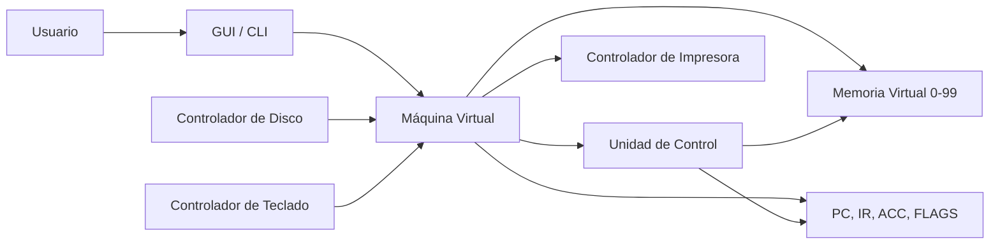
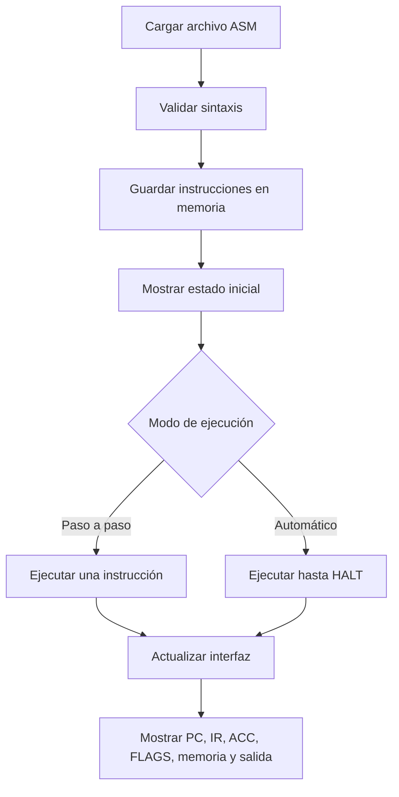
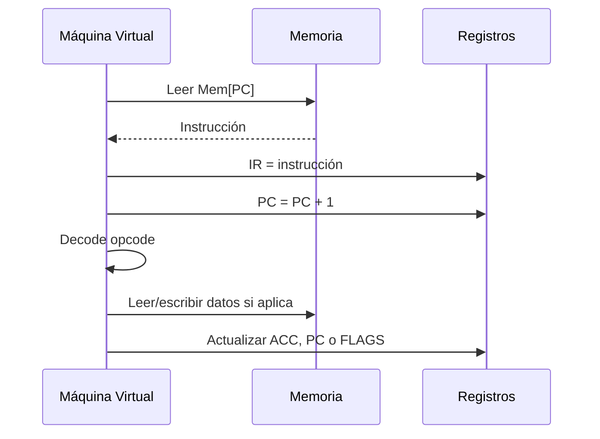

# Documento técnico y diseño del simulador

## Portada

**Proyecto:** Implementación de una Máquina Virtual Simple  
**Asignatura:** Arquitectura de Sistemas Operativos  
**Grupo:** 13  
**Lenguaje:** Python 3  
**Producto:** Simulador de máquina virtual con memoria, registros, ciclo Fetch-Decode-Execute, dispositivos virtuales, pruebas y documentación.

## Introducción

Una máquina virtual permite simular por software el comportamiento básico de un procesador. En este proyecto se implementa una máquina virtual simple capaz de cargar programas escritos en un lenguaje de instrucciones reducido, almacenarlos en memoria y ejecutarlos paso a paso o de forma automática.

El simulador muestra la relación entre hardware y software mediante componentes como memoria principal, contador de programa, registro de instrucción, acumulador, banderas de estado y controladores de dispositivos. Su propósito principal es comprender cómo una instrucción pasa por las fases Fetch, Decode y Execute hasta modificar registros, memoria o dispositivos de entrada y salida.

## Planteamiento del problema

En los sistemas operativos reales, el procesador, la memoria y los dispositivos interactúan constantemente. Sin embargo, estos mecanismos suelen ser difíciles de observar directamente porque ocurren a bajo nivel. El problema consiste en construir una herramienta didáctica que muestre de forma clara cómo una CPU obtiene instrucciones desde memoria, las interpreta, ejecuta operaciones y actualiza su estado interno.

## Objetivo general

Desarrollar una máquina virtual simple que interprete y ejecute un conjunto básico de instrucciones, simulando el funcionamiento de un procesador mediante memoria, registros, contador de programa, registro de instrucción, acumulador y dispositivos virtuales.

## Objetivos específicos

- Implementar una memoria virtual capaz de almacenar instrucciones y datos.
- Simular registros básicos: PC, IR, ACC y FLAGS.
- Ejecutar instrucciones mediante el ciclo Fetch-Decode-Execute.
- Permitir carga de programas desde archivos `.asm`.
- Ofrecer ejecución paso a paso y ejecución automática.
- Mostrar el estado de memoria, registros e instrucción actual.
- Simular controladores de teclado, disco e impresora.
- Detectar errores de sintaxis, instrucciones inválidas, accesos fuera de memoria y programas sin `HALT`.
- Validar el funcionamiento mediante casos de prueba.

## Justificación

El proyecto facilita la comprensión de conceptos fundamentales de arquitectura y sistemas operativos. Al observar cambios en PC, IR, ACC, FLAGS y memoria, el estudiante puede relacionar conceptos teóricos con una ejecución concreta. Además, el simulador permite ensayar errores controlados y ver cómo una máquina virtual debería responder ante instrucciones inválidas o accesos incorrectos.

## Marco teórico

**Máquina virtual:** Entorno simulado que ejecuta instrucciones como si fueran procesadas por una arquitectura propia.

**Memoria:** Conjunto de celdas direccionables donde se guardan instrucciones y datos. En este simulador existen 100 posiciones, numeradas de 0 a 99.

**PC, Program Counter:** Registro que contiene la dirección de la siguiente instrucción a ejecutar.

**IR, Instruction Register:** Registro que guarda la instrucción obtenida durante la fase Fetch.

**ACC, acumulador:** Registro principal usado para operaciones aritméticas y transferencia de datos.

**FLAGS:** Registro de estado. Se implementan las banderas `Z` y `N`. `Z` indica si el acumulador es cero; `N` indica si el acumulador es negativo.

**Unidad de control:** Lógica que interpreta la instrucción actual y decide qué operación realizar.

**Controladores de dispositivos:** Componentes simulados que representan la comunicación con teclado, disco e impresora.

## Diseño de la arquitectura

La arquitectura se divide en cinco módulos principales:

- **Memoria virtual:** arreglo de 100 celdas. Puede contener objetos `Instruction` o datos enteros.
- **Registros:** `PC`, `IR`, `ACC`, `flag_z`, `flag_n` y `halted`.
- **Unidad de control:** método `step()`, que ejecuta Fetch, Decode y Execute.
- **Controladores de dispositivos:** teclado (`INPUT`), disco (`load_program_from_disk`) e impresora (`OUTPUT`).
- **Interfaz:** modo gráfico con Tkinter y modo consola interactiva.



## Diseño del conjunto de instrucciones

| Instrucción | Operando | Función |
|---|---:|---|
| `LOAD` | Dirección | Carga en `ACC` el valor almacenado en memoria. |
| `STORE` | Dirección | Guarda el valor de `ACC` en memoria. |
| `ADD` | Dirección | Suma al `ACC` el valor de memoria. |
| `SUB` | Dirección | Resta al `ACC` el valor de memoria. |
| `JMP` | Dirección | Cambia el `PC` a la dirección indicada. |
| `JZ` | Dirección | Salta si la bandera `Z` está activa. |
| `JNZ` | Dirección | Salta si la bandera `Z` no está activa. |
| `INPUT` | Ninguno | Lee un número desde teclado y lo coloca en `ACC`. |
| `OUTPUT` | Ninguno | Envía el valor de `ACC` a la impresora simulada. |
| `HALT` | Ninguno | Finaliza la ejecución. |

El simulador implementa 10 instrucciones, superando el mínimo recomendado de 8.

## Diseño del ciclo de instrucción

El ciclo de ejecución se realiza en el método `step()`:

1. **Fetch:** se lee la celda de memoria apuntada por `PC`.
2. **Decode:** se valida que la celda contenga una instrucción y se separan opcode y operando.
3. **Execute:** se ejecuta la operación correspondiente.
4. **Actualizar PC:** normalmente el `PC` aumenta antes de ejecutar; en saltos se reemplaza por la dirección destino.
5. **Actualizar FLAGS:** se actualizan `Z` y `N` según el valor final de `ACC`.

```mermaid
flowchart TD
    A[Inicio de step] --> B{¿Máquina detenida?}
    B -- Sí --> C[Retornar sin ejecutar]
    B -- No --> D[Fetch: leer Mem[PC]]
    D --> E[IR = instrucción]
    E --> F[PC = PC + 1]
    F --> G[Decode: identificar opcode]
    G --> H[Execute: operar sobre ACC, memoria o PC]
    H --> I[Actualizar FLAGS]
    I --> J{¿HALT?}
    J -- Sí --> K[Detener VM]
    J -- No --> L[Siguiente instrucción]
```

## Diseño de la memoria

- **Tamaño:** 100 celdas.
- **Direcciones válidas:** 0 a 99.
- **Instrucciones:** se cargan desde archivos `.asm` iniciando en dirección 0.
- **Datos:** se guardan en direcciones indicadas por el programa. En los casos de prueba se usan direcciones separadas para evitar sobrescribir instrucciones.
- **Control de límites:** cualquier acceso fuera de 0 a 99 produce `MemoryOutOfBoundsException`.

## Lenguaje de instrucciones

Cada línea contiene una instrucción y, si aplica, un operando entero:

```asm
LOAD 10
ADD 11
STORE 20
OUTPUT
HALT
```

Se permiten comentarios con `#` o `//`. Las instrucciones sin operando no aceptan valores adicionales. Las instrucciones con operando requieren una dirección válida.

## Diagramas de funcionamiento

### Diagrama general



### Ciclo Fetch-Decode-Execute



## Casos de prueba

| Prueba | Archivo | Resultado esperado |
|---|---|---|
| Suma | `test1_suma.asm` | `ACC = 30`, `Mem[20] = 30` |
| Resta | `test2_resta.asm` | `ACC = 20`, `Mem[20] = 20` |
| Almacenamiento | `test3_almacenamiento.asm` | `Mem[20] = 30` |
| Condicional | `test4_condicional.asm` | `ACC = 111`, salto `JZ` correcto |
| Bucle / salto | `test5_bucle.asm` | `ACC = 6`, `Mem[53] = 6` |
| Entrada y salida | `test6_entrada_salida.asm` | Con entrada `7`, `ACC = 7`, `Mem[20] = 7` |

## Resultados esperados

El simulador debe cargar los programas, ejecutar cada instrucción, actualizar correctamente registros y memoria, mostrar el estado de la máquina y detenerse al encontrar `HALT`. En caso de errores, debe informar la causa sin continuar una ejecución inválida.

## Conclusiones

El simulador implementa una máquina virtual didáctica que permite observar el flujo completo de ejecución de instrucciones. La separación entre memoria, registros, unidad de control y dispositivos facilita comprender el papel de cada componente. Los casos de prueba demuestran operaciones aritméticas, almacenamiento, saltos condicionales, bucles y entrada/salida.

## Bibliografía

- Tanenbaum, A. S. y Bos, H. *Modern Operating Systems*.
- Silberschatz, A., Galvin, P. B. y Gagne, G. *Operating System Concepts*.
- Stallings, W. *Computer Organization and Architecture*.
- Documentación oficial de Python: https://docs.python.org/3/


## Actualizacion VM Studio (Python autorizado)

Python fue autorizado por el docente, segun confirmacion del grupo. Se mantienen los componentes y objetivos de la propuesta.

- Estado ERROR: conserva el PC fallido y exige reinicio. Cancelar INPUT conserva la instruccion pendiente sin crear un error permanente.
- Z inicia activa porque ACC inicia en cero. FLAGS se actualiza tras cada instruccion completada.
- El motor registra FETCH, DECODE y EXECUTE en `last_trace`; las tarjetas muestran las fases de la ultima instruccion. El paso ejecuta una instruccion completa.
- `KeyboardController`, `DiskController` y `PrinterController` ofrecen controladores separados sobre las funciones compartidas de dispositivos.
- DATA direccion valor declara enteros iniciales. No cuenta como instruccion. Se rechazan duplicados, direcciones invalidas y superposicion con codigo antes de modificar la VM.
- El limite de ciclos detiene bucles incluso cuando existe HALT. Alcanzar HALT en el ultimo ciclo permitido es correcto.
- La GUI separa editor, traza, impresora y ayuda; permite filtrar memoria, pausar, ajustar velocidad y exportar evidencia JSON.
- El punto de entrada simulador_vm.py abre src/vm_studio/simulador_vm.py; el acceso antiguo se conserva en archive/.

## Recomendaciones

Ejecutar el verificador funcional, las pruebas de regresion y la verificacion de Tkinter antes de entregar. Revisar visualmente la GUI en el equipo de defensa. Exportar evidencia de suma, salto, entrada/salida y error. Renderizar los diagramas Mermaid antes de imprimir el documento. Completar integrantes, docente y fecha en la portada. No afirmar que tener HALT impide todos los bucles.
