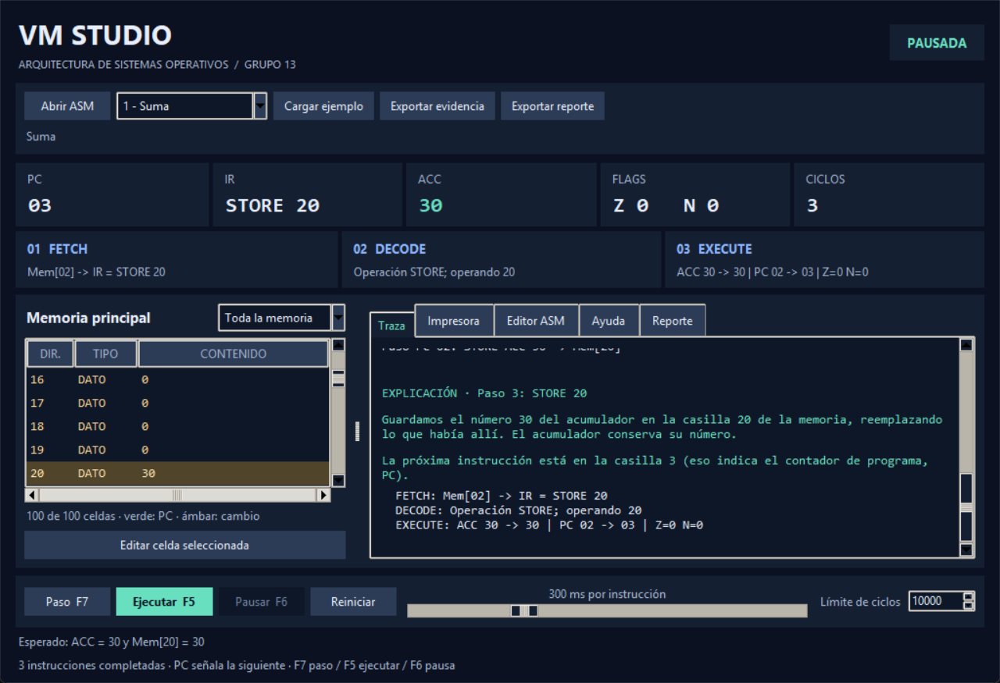

# Manual de usuario — máquina virtual simple

**Fecha de revisión:** 27 de octubre de 2026.

## Requisitos e inicio

Utiliza Python 3.10 o superior con Tkinter. La aplicación no requiere paquetes externos. El proyecto conserva Python según autorización consignada por el grupo.

Abre una terminal en la raíz del proyecto y ejecuta:

```powershell
python simulador_vm.py
```

Para utilizar el menú de consola:

```powershell
python simulador_vm.py --cli
```

En Windows puedes sustituir `python` por `py` si ese es el comando disponible. `python -m tkinter` permite comprobar si la instalación dispone de Tkinter. ReportLab solo se utiliza para regenerar la documentación PDF y no hace falta para abrir el simulador.

También puedes abrir `INICIAR_VM.cmd` con doble clic. Si recibiste un ZIP, primero descomprime la carpeta completa. No ejecutes el archivo dentro del ZIP ni separes `simulador_vm.py` de `src/` y `examples/`.

Para consultar todas las opciones disponibles, ejecuta `python simulador_vm.py --help`. Para cerrar la ventana utiliza su botón de cierre; en consola selecciona 0.

## Elementos de la interfaz gráfica

- **Estado:** indica si la máquina espera un programa, está lista, ejecutándose, pausada, finalizada o con error.
- **Registros:** muestran PC, IR, ACC, FLAGS y ciclos completados. PC señala la siguiente instrucción; la fila destacada en memoria corresponde a esa dirección.
- **Fases:** muestran Fetch, Decode y Execute de la última instrucción. Un paso ejecuta las tres fases completas.
- **Memoria:** contiene 100 celdas, de 0 a 99. Sus filtros permiten revisar toda la memoria, instrucciones, datos o datos distintos de cero. Los cambios de memoria recientes se distinguen del siguiente PC.
- **Traza:** registra operaciones, cambios de estado y explicaciones en palabras simples.
- **Impresora:** reúne los valores emitidos por OUTPUT.
- **Editor ASM:** permite escribir, guardar y cargar un programa. Modificar el texto no cambia el programa activo hasta cargarlo; revisar el aviso de cambios pendientes antes de ejecutar.
- **Reporte:** resume el estado y el historial; se puede exportar HTML, CSV o JSON.
- **Ayuda:** resume instrucciones y atajos.



## Primera ejecución: suma de 10 y 20

1. Selecciona el ejemplo Suma y pulsa Cargar ejemplo, o pega el siguiente código en Editor ASM y pulsa Cargar desde editor.
2. Comprueba que PC y ACC están en cero y las celdas 10 y 11 contienen 10 y 20.
3. Pulsa Paso o F7. LOAD 10 deja ACC en 10.
4. Pulsa Paso otra vez. ADD 11 deja ACC en 30.
5. Completa los pasos restantes. STORE 20 guarda 30, OUTPUT imprime 30 y HALT termina.

```asm
DATA 10 10
DATA 11 20
LOAD 10
ADD 11
STORE 20
OUTPUT
HALT
```

El resultado final debe ser PC = 5, IR = HALT, ACC = 30, Mem[20] = 30 e impresora con 30. Las tarjetas de fases corresponden entonces a HALT; la pestaña Traza conserva también la explicación de las instrucciones anteriores.

## Reglas para escribir programas

Cada línea contiene una operación. LOAD, STORE, ADD, SUB, JMP, JZ y JNZ requieren una dirección entre 0 y 99. INPUT, OUTPUT y HALT no reciben operandos. Todo programa debe incluir HALT.

`DATA dirección valor` coloca un entero inicial en memoria. No cuenta como instrucción, dirección de código ni ciclo. No se permiten declaraciones repetidas o sobre el código inicial. Las instrucciones empiezan en la dirección cero y se cuentan sin incluir comentarios o DATA; los saltos usan esas direcciones, no los números de línea del archivo.

En `ADD 11`, 11 es una dirección: se suma el número almacenado allí. Para sumar un valor fijo se declara previamente con DATA. ACC se utiliza implícitamente; `LOAD ACC` no es una sintaxis válida. Los comentarios pueden comenzar con `#` o `//`.

## Controles de ejecución

| Control | Acción |
|---|---|
| Paso / F7 | Completa una instrucción y actualiza el estado. |
| Ejecutar / F5 | Inicia o continúa la ejecución automática. |
| Pausar / F6 | Detiene la programación de las siguientes instrucciones. |
| Reiniciar | Restaura el programa gráfico y sus datos iniciales. |
| Velocidad | Ajusta la espera en milisegundos entre instrucciones automáticas. |
| Límite de ciclos | Limita los ciclos totales completados desde la carga o reinicio. |

Los pasos manuales también cuentan para el límite de la GUI. Si HALT se completa en el último ciclo permitido, la terminación es correcta. Un programa puede contener HALT y repetir un salto sin llegar a él; por eso existe el límite.

Después de HALT, utiliza Reiniciar para volver a ejecutar. Una edición de datos antes del primer paso se conserva como dato inicial al reiniciar; una edición después de empezar solo afecta al recorrido actual. Para cambiar una instrucción usa el editor y vuelve a cargar el código.

## Teclado y salida

El ejemplo Entrada y salida pide un entero. Introduce 7 y completa el programa para comprobar ACC = 7, Mem[20] = 7 e impresora con 7.

Si cancelas el diálogo de INPUT, PC, ACC y el contador de ciclos se mantienen y la instrucción queda pendiente. Pulsa Paso o Ejecutar para reintentar. Cancelar la entrada no exige reiniciar.

## Errores y recuperación

| Situación | Diagnóstico y solución |
|---|---|
| Archivo no encontrado | Comprueba la ruta del ASM; el programa anterior permanece cargado. |
| Instrucción desconocida o operandos incorrectos | Corrige la línea indicada y vuelve a cargar. |
| LOAD ACC u otro registro como operando | ACC se utiliza implícitamente. Escribe una dirección entera; por ejemplo, LOAD 10. |
| DATA repetido, sobre código o fuera de rango | Elige una dirección de datos libre entre 0 y 99. |
| Programa sin HALT | Añade la terminación y vuelve a cargar. |
| Lectura de código como dato | Revisa la dirección usada por LOAD, ADD o SUB. |
| Fetch encuentra un dato | Revisa el destino de salto o si STORE sobrescribió código. |
| Límite de ciclos alcanzado | Revisa el bucle o aumenta el límite si la duración es intencionada; después reinicia. |
| Estado ERROR | Lee el diagnóstico, corrige la causa y reinicia o carga un programa válido. |

Un error de ejecución conserva PC en la instrucción fallida y bloquea pasos posteriores. La consola también conserva y muestra el diagnóstico al consultar registros. Una carga inválida no borra el programa previo.

## Archivos y evidencias

Guardar ASM guarda el texto actual del editor. Para ejecutarlo primero debes cargarlo. Abrir un archivo o cargar un ejemplo instala su código y sus datos iniciales.

Exportar evidencia guarda un JSON con código, datos iniciales, registros, memoria, entradas, impresora, historial, ediciones manuales, traza y fases. Exportar reporte permite elegir HTML para abrir o imprimir en un navegador, CSV para Excel o JSON. La pestaña de reporte resume el estado y el historial de la ejecución. Exporta después de completar un caso para documentar su resultado; también puedes exportar una pausa o un error, que quedarán identificados con ese estado.

Un reporte es una instantánea: seguir ejecutando no modifica el archivo ya guardado. HTML funciona sin conexión. En CSV, las filas incluyen un campo de tipo para distinguir registros, pasos, memoria, entradas, salidas y ediciones. Al exportar no se abre automáticamente un navegador.

Para regenerar las evidencias de entrega desde terminal:

```powershell
python scripts/generar_evidencias.py --incluir-gui
```

El informe generado queda en `docs/EVIDENCIAS_PRUEBAS.md` y los archivos de detalle en `docs/evidencias/`. La opción de GUI necesita una sesión de escritorio. Sin `--incluir-gui` se evita abrir ventanas y se identifica esa condición en el resultado.

## Uso de la consola

El menú permite cargar uno de los seis casos o un archivo, ejecutar un paso, ejecutar todo, consultar registros y memoria, modificar una celda y reiniciar. Los archivos de ejemplo están en `examples/`.

La opción Ejecutar todo utiliza por defecto un límite total de 10000 ciclos desde carga o reinicio. También cuentan los pasos manuales; pausar o reanudar no restablece el contador. Si aparece ERROR, la consulta de registros muestra el diagnóstico y debes reiniciar o cargar un programa válido antes de seguir.

La opción Reiniciar de consola restaura el programa cargado y sus datos iniciales, igual que el botón gráfico. Una edición de datos anterior al primer paso se incorpora a esos datos iniciales; una edición posterior solo afecta a esa ejecución. La opción 9 exporta el reporte indicando una ruta con extensión `.html`, `.csv` o `.json`. EOF y Ctrl+C cierran la sesión sin mostrar un error interno de Python.

## Ejecución por archivo sin interacción

Desde la raíz del proyecto:

```powershell
python simulador_vm.py --archivo examples/test1_suma.asm --reporte output/reportes/suma.html
python simulador_vm.py --archivo examples/test6_entrada_salida.asm --entrada 7 --reporte output/reportes/entrada.csv
python simulador_vm.py --archivo examples/multiplicacion.asm --entrada -4 --entrada 3 --reporte output/reportes/multiplicacion.json
```

Cada `--entrada ENTERO` corresponde a un INPUT en orden. Si falta un valor, el programa informa el error y termina; no espera teclado ni abre ventanas. Con `--reporte` también puedes conservar ese diagnóstico. `--max-ciclos 10000` fija el límite total. Un recorrido correcto devuelve código de salida 0; un error de carga, ejecución o guardado devuelve 1. `python simulador_vm.py --help` muestra las opciones.

## Material para exponer y compartir

El PowerPoint se encuentra en `output/presentacion/DEFENSA_GRUPO13.pptx`. El guion editable para tres integrantes está en `output/exposicion/GUIA_TRES_INTEGRANTES.docx` y su fuente en `docs/exposicion/GUIA_TRES_INTEGRANTES.md`. La defensa debe durar de 15 a 20 minutos e incluir una ejecución por pasos, automática y un error controlado.

El documento técnico editable está en `output/word/ENTREGA_GRUPO13.docx` y su versión imprimible en `output/pdf/ENTREGA_GRUPO13.pdf`. Los datos de portada deben completarse con la información real del grupo. Para compartir código y materiales juntos, utiliza `output/compartir/VM_STUDIO_GRUPO13.zip`; debe descomprimirse antes de ejecutar.

## Ejemplo adicional de multiplicación

`examples/multiplicacion.asm` multiplica mediante sumas sucesivas. Solicita dos enteros: el primero puede tener cualquier signo; el segundo debe ser no negativo. Introducir cero produce cero. Un segundo entero negativo no satisface la condición del algoritmo y provoca un bucle que detiene el límite de ciclos.
